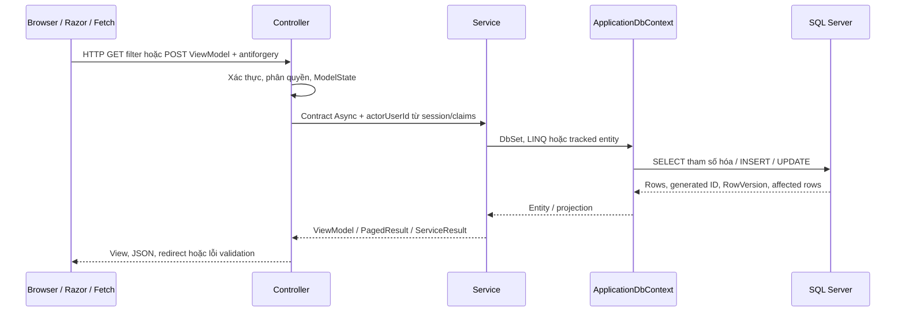

# Luồng dữ liệu và 5 câu hỏi lý thuyết

Tên ViewModel và interface được đối chiếu từ `ViewModels/` và `Services/Interfaces/ServiceContracts.cs`. SQL dưới đây minh họa dạng lệnh, không phải bản chụp SQL profiler. Controller kiểm tra ModelState, service kiểm tra nghiệp vụ/quyền, DbContext thực hiện đọc/ghi. View/JSON chỉ dùng ViewModel.

## Room: module cá nhân mặc định đề xuất

| HTTP/action | Input/output | LINQ hoặc thao tác chính | SQL và lượt về |
|---|---|---|---|
| GET Admin/Room/Index | RoomFilter → PagedResult<RoomViewModel> | Rooms.AsNoTracking; Where RoomName/Status/MinimumCapacity/IsDisabled; OrderBy + ThenBy RoomId; CountAsync trước Skip/Take; projection rồi ToListAsync | SELECT COUNT(*) và SELECT ... ORDER BY ... OFFSET/FETCH; tổng số và trang dữ liệu về Razor |
| GET Admin/Room/Details hoặc Edit | id → RoomViewModel | Where RoomId; Select; FirstOrDefaultAsync | SELECT TOP(1); không thấy → controller xử lý NotFound |
| GET Admin/Room/Create | RoomViewModel mới | Không ghi DB | Render form |
| POST Admin/Room/Create hoặc Edit | RoomViewModel + actorUserId | Admin gate; validate; AnyAsync kiểm tra tên trùng; FindAsync/new Room; SaveChangesAsync trong transaction | INSERT/UPDATE Room và INSERT AuditLog; lấy ID; xóa cache ROOM_LIST; ServiceResult → redirect/lỗi |
| GET Admin/Room/Delete | id → RoomViewModel | Đọc bản ghi để xác nhận | SELECT; chưa thay đổi dữ liệu |
| POST Admin/Room/Delete | id + actorUserId | DisableAsync: IsDisabled = true | UPDATE Room, INSERT AuditLog; giữ Meeting.RoomId; invalidation cache rồi redirect |
| GET Room/Available | start, end, minimumCapacity, excludeMeetingId | Active và không disabled; Capacity >= min; !Meetings.Any(overlap Confirmed) | SELECT với NOT EXISTS; danh sách RoomViewModel về JSON |

Overlap dùng `existing.StartTime < requested.EndTime && requested.StartTime < existing.EndTime`. Vì dùng dấu `<`, lịch 09:00–10:00 và 10:00–11:00 được chấp nhận. Lookup cache chỉ giữ phòng Active chưa disable; CRUD/disable thành công phải xóa cache.

## Meeting và RSVP: luồng dùng chung

| HTTP/action | ViewModel | Xử lý service và SQL | Kết quả |
|---|---|---|---|
| GET Meeting/Index, Details; GET api/meetings | MeetingFilter, MeetingDetailsViewModel; API trả PagedResult<MeetingDetailsViewModel> | AsNoTracking; quyền Admin hoặc organizer/participant; filter/sort/count/page; SELECT và JOIN/projection | Razor hoặc JSON danh sách phân trang; chưa dùng CalendarEventViewModel |
| GET Meeting/Create, Edit | MeetingEditViewModel | Đọc lookup Room/User và chi tiết; SELECT | Form có RowVersion khi edit |
| POST Meeting/Create, Edit | MeetingEditViewModel | Actor active, Admin/Organizer; ownership; tương lai; capacity gồm organizer; users active; overlap; Serializable transaction; INSERT/UPDATE Meeting và participants, INSERT AuditLog | Commit rồi queue thông báo tùy SMTP; ServiceResult → redirect hoặc lỗi |
| GET/POST Meeting/Cancel hoặc Meeting/Delete | CancelMeetingViewModel | GET xác nhận; POST kiểm tra quyền sở hữu/Admin, lý do hủy, RowVersion; UPDATE Status, CancelledAt/By/Reason + AuditLog | Giữ lịch sử; lịch Cancelled không chặn phòng. Admin/Meeting/Cancel và Delete chỉ GET redirect sang controller công khai |
| GET Meeting/RsvpTracking/1 hoặc Meeting/Rsvp/1 | RsvpFilter → PagedResult<RsvpTrackingViewModel> | IRsvpService.QueryAsync: organizer/Admin; Where MeetingId/Status/tên/email, OrderBy, Count, Skip/Take; JOIN User | Trang theo dõi đủ Pending/Accepted/Declined |
| POST Meeting/Respond hoặc Meeting/Rsvp | meetingId/id và RsvpStatus | RespondAsync: actor active, được mời, lịch Confirmed chưa bắt đầu; chỉ Accepted/Declined; UPDATE MeetingParticipant.Status/RespondedAt + AuditLog | Redirect kèm TempData; không trả JSON, không cho tự ghi Pending hay status lạ |

`RowVersion` là token do SQL Server sinh, không phải ngày giờ. EF dùng token gốc trong điều kiện `UPDATE ... WHERE MeetingId = @id AND RowVersion = @original`; không khớp thì concurrency conflict, yêu cầu tải lại. Serializable bảo vệ đọc overlap và ghi reservation trong cùng transaction; RowVersion giải quyết cập nhật bản ghi cũ, không tự giải quyết hai lịch mới trùng nhau.

## User, Department, Account và Report

| Module/HTTP | ViewModel/contract | Roundtrip |
|---|---|---|
| GET/POST Admin/User CRUD, Delete | UserFilter/UserCreateViewModel/UserEditViewModel; IUserService | SELECT filter/order/count/page với Role/Department; POST Admin kiểm tra email unique và department active, hash password khi create; INSERT/UPDATE User và AuditLog. Delete là disable, không DELETE SQL |
| GET/POST Admin/Department CRUD, Delete | DepartmentFilter/DepartmentViewModel; IDepartmentService | SELECT và pipeline; INSERT/UPDATE + audit/cache invalidation; disable bị từ chối khi còn user active |
| POST Account/Login; GET/POST Profile | Login/Profile/ChangePasswordViewModel; IAccountService | SELECT User/Role/Department, kiểm tra password hash và disabled; UPDATE hồ sơ/hash, audit. Controller phát cookie; Profile dùng View/redirect, không trả JSON. ValidateSessionAsync kiểm tra tài khoản/phòng ban active và role hiện tại trên request; khóa tài khoản làm cookie bị reject và sign out |
| GET Admin/Report | ReportFilter → ReportResult; IReportService | Meetings.AsNoTracking với `StartTime < To && EndTime > From`, optional RoomId; SELECT meeting projection; GROUP BY RSVP của lịch Confirmed; tổng hợp phòng/thời lượng từ projection về View |

Report dùng khoảng nửa mở `[From, To)`: đếm các lịch giao khoảng, `CancelledMeetings` riêng; số lượt RSVP chỉ từ lịch Confirmed; TotalHours chỉ cộng phần giao khoảng của lịch Confirmed. Không có INSERT/UPDATE Report và không tạo bảng Report.

## 5 câu hỏi lý thuyết

1. **EF Core là gì?** Là ORM của .NET: ánh xạ đối tượng/entity sang bảng, dịch LINQ được hỗ trợ thành SQL và ánh xạ kết quả về C#. LINQ dùng tham số giúp tránh SQL injection; raw SQL nối chuỗi input vẫn không an toàn. Ví dụ RoomService không tự ghép chuỗi SQL từ SearchString.
2. **DbContext có vai trò gì?** Là đơn vị làm việc với database, chứa DbSet, metadata quan hệ, change tracker và SaveChanges. ApplicationDbContext có 7 DbSet; OnModelCreating nạp Fluent API. DI mặc định Scoped cho request. DbContext không thread-safe, hai tác vụ SQL đồng thời phải dùng instance riêng.
3. **Migration dùng để làm gì?** Quản lý thay đổi schema Code First bằng mã Up/Down và snapshot. InitialCreate hiện đã có; Update-Database áp dụng những migration chưa chạy. Khi thay model tạo migration tên mới và kiểm tra SQL trước khi áp dụng; rollback có thể mất dữ liệu, không coi là backup.
4. **Vì sao dùng async?** SQL là I/O: await ToListAsync/SaveChangesAsync giải phóng luồng trong lúc chờ, giúp server phục vụ nhiều request. Async không làm từng query tự nhanh hơn và không tự đảm bảo chống đặt trùng; vẫn cần transaction và ràng buộc. Không chạy nhiều query song song trên cùng DbContext.
5. **Khi nào dùng AsNoTracking?** Với Index, Details, lookup, RSVP tracking, báo cáo chỉ đọc. Giảm chi phí change tracker; projection ra ViewModel còn tránh truyền entity cho View. Khi cần sửa entity rồi SaveChanges hãy dùng truy vấn tracked hoặc attach và cấu hình OriginalValue đúng, nhất là RowVersion.

Phần lý thuyết theo mục 8 rules, bổ sung giới hạn kỹ thuật từ các implementation đang có. Phần RSVP trả lời và module Meeting/User là phạm vi tích hợp ứng dụng, không phải lời xác nhận phân công cá nhân.
