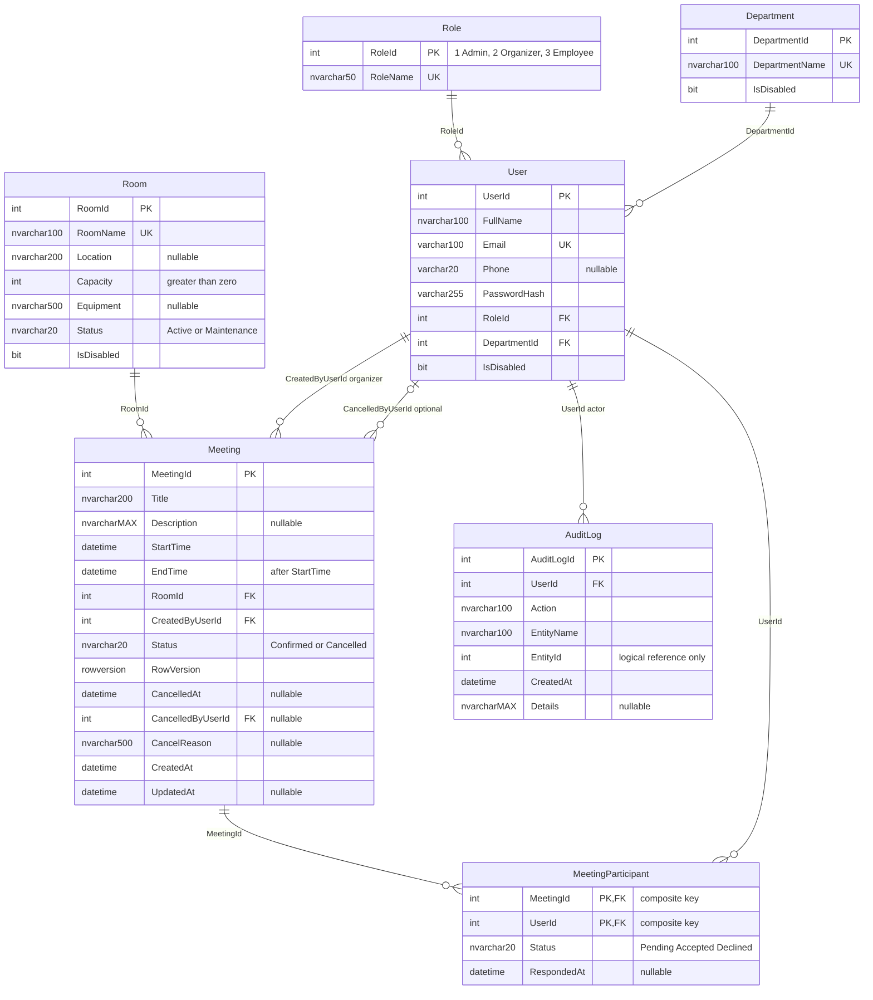

# ERD: 7 thực thể

Theo G1/G2 rules và `Data/Configurations/DomainConfiguration.cs`. AuditLog cùng các trường đánh dấu bổ sung trong [ENTITY_DICTIONARY.md](ENTITY_DICTIONARY.md) là baseline suy luận ngoài SRS, chưa phải xác nhận nhóm.

Mỗi User bắt buộc có một Role và một Department. Mỗi Meeting bắt buộc có một Room và một organizer; có thể không có người hủy khi chưa hủy. Một bản ghi MeetingParticipant bắt buộc thuộc đúng một Meeting và một User; cặp MeetingId/UserId duy nhất tạo quan hệ n-n Meeting/User. Parent có thể có 0 bản ghi con; `o{` không có nghĩa FK con nullable.

MeetingParticipant bị cascade khi hard delete Meeting ở cấp schema, nhưng luồng nghiệp vụ hủy dùng UPDATE Status nên vẫn giữ participant. Các quan hệ còn lại Restrict để giữ lịch sử và tránh multiple cascade paths SQL Server, đặc biệt hai FK từ Meeting đến User. AuditLog.EntityId không có đường quan hệ vật lý đến mọi bảng: nó chỉ là tham chiếu logic theo EntityName.

Chỉ mục bổ sung `(RoomId, StartTime, EndTime)` hỗ trợ tìm trùng lịch. RowVersion bảo vệ cập nhật; kiểm tra overlap của lịch mới cần transaction Serializable, không phải unique constraint trên thời gian.
